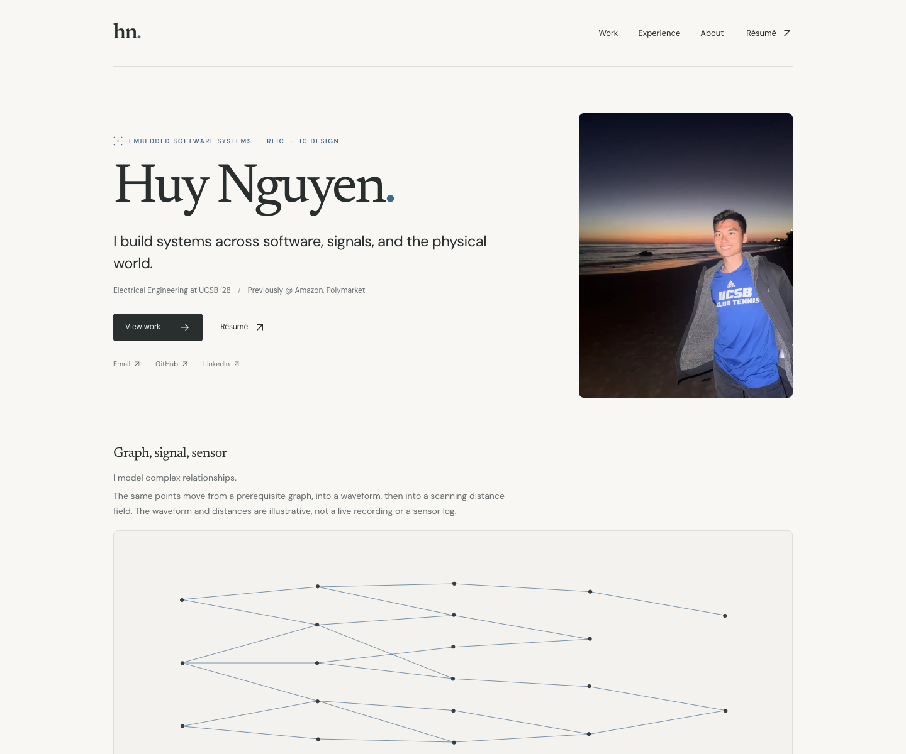

# Huy Nguyen — software & embedded systems

> I build products that connect software, signals, and the physical world.

[View the live portfolio](https://huythedev.vercel.app/) · [Open my résumé](https://huythedev.vercel.app/Huy%20Nguyen%27s%20Resume.pdf) · [LinkedIn](https://www.linkedin.com/in/huynguyen06/)



This public repository powers my personal portfolio: a fast, accessible way to explore my work in software, embedded systems, real-time interaction, and signal processing. It is intentionally light on decoration and built to make the engineering evidence easy to find.

## What to explore

| Project | Engineering focus | Evidence |
| --- | --- | --- |
| [iGauchoBack](https://igauchoback.vercel.app/) | Turning inconsistent course catalogs into validated prerequisite graphs | 70+ interactive degree roadmaps across multiple UC campuses |
| LiDAR Security System | Arduino, I2C sensing, adaptive baselines, and noisy-reading recovery | 180° scanning detection system; top-five Northrop Grumman expo placement |
| [Orbit AFE](https://orbitafe.vercel.app/) | Real-time maps, opt-in presence, messaging, and connection matching | Built and launched in 24 hours across 25+ intern hubs |
| Chromatic Guitar Tuner | Live audio capture, FFT pitch detection, and thread-safe buffering | Responsive sharp / flat / in-tune feedback from microphone input |
| [The Hobbiest](https://thehobbiest.vercel.app/) | Full-stack publishing, interactive maps, and owner-only content workflows | Keyboard-accessible identity map and a custom editorial workflow |

Each project has a focused breakdown covering the problem, my contribution, the key engineering tradeoff, result, and supporting evidence. Live projects and the LiDAR poster are linked where available.

## Why this portfolio is built this way

Recruiters should be able to understand what I build without digging through a hidden menu or a long project diary. The homepage puts my technical direction, résumé, contact information, and project evidence up front. The project carousel keeps the interface compact while making the full project set easy to browse.

The guitar-tuner card includes a silent, keyboard-accessible interactive concept demo. It visualizes a synthesized A4 signal from −50 to +50 cents; it does not claim to run the original Python microphone application.

## Tech Stack

- **Next.js App Router + TypeScript** for static, typed pages and project routes
- **React + Tailwind CSS** for a responsive editorial interface
- **Local variable fonts and optimized images** for a lightweight visual system
- **No database or runtime application secrets** required to view the site
- **Accessible by default:** visible focus states, semantic navigation, reduced-motion support, meaningful image descriptions, and keyboard-operable interactive controls

## Run locally

Requires Node.js 22.13–24 and pnpm 11.25.0.

```sh
pnpm install --frozen-lockfile
pnpm dev
```

Open the local URL printed by Next.js. No API keys or environment variables are required.

## Quality checks

```sh
pnpm lint
pnpm typecheck
pnpm test
pnpm build
pnpm test:browser
```

For the same verification sequence used by the production deployment, run:

```sh
pnpm build:verified
```

The test suite covers project content and routes, the interactive tuner, responsive layouts, accessibility rules, security headers, résumé behavior, metadata, and production navigation. Run `pnpm audit:security` to check dependencies for known vulnerabilities. Browser tests require a production build and a working local browser environment.

## Repository guide

- `lib/content.ts` — factual project and experience content; `featured` selects the homepage lead and `visual` selects a diagram without branching on project slugs
- `lib/links.ts` — shared résumé filename, URLs, and contact destinations
- `components/about/content.ts` — editable wheel labels, answers, icons, and optional images
- `components/signature-system/` — visualization, pointer lifecycle, and independently tested animation math
- `app/projects/[slug]` — statically generated project breakdown pages
- `components/project-carousel.tsx` — accessible homepage project browsing controls
- `components/tuner.tsx` — silent synthesized pitch concept demo
- `public/` — résumé, LiDAR poster, portrait, and project visuals
- `SECURITY.md` — browser security policy and dependency-audit notes

Keep content in these data files and interaction logic beside its component. Tests should protect behavior and invariants rather than duplicate editorial copy or freeze the number of projects. Browser tests run against a production build and cover both desktop and touch layouts.

## Deployment

This repository deploys through Vercel. Pushes to `main` publish to [huythedev.vercel.app](https://huythedev.vercel.app/); other branches receive preview deployments. Before pushing a change, run `pnpm build:verified`. After deployment, verify the public site in a logged-out browser session.

No credentials, API keys, or private environment files are required for local development. Keep secrets out of source control, commits, issues, and pull requests. If a secret is exposed, revoke it through the relevant provider and remove it from the repository history.

---

Interested in building something useful? Reach me through [LinkedIn](https://www.linkedin.com/in/huynguyen06/) or the contact details in the [live portfolio](https://huythedev.vercel.app/).
